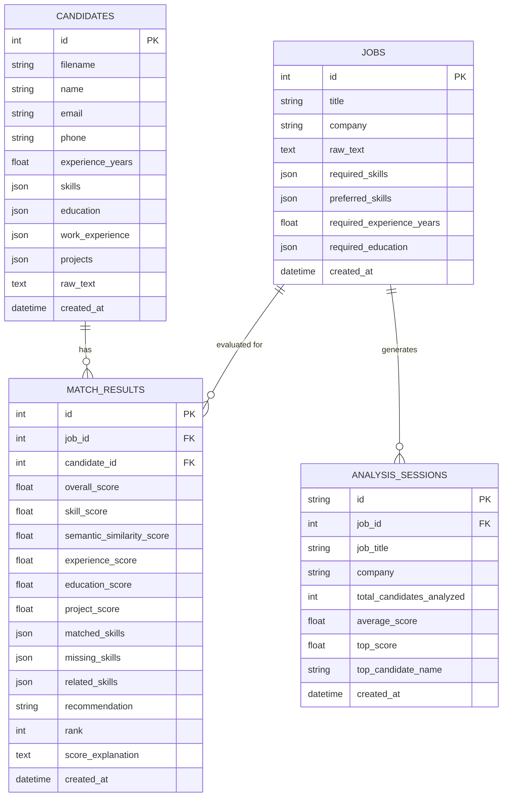

# AI Resume Matcher – Intelligent Candidate Ranking System

An enterprise-grade, full-stack recruitment intelligence platform that automates resume parsing, computes semantic vector matching against job descriptions using Sentence Transformers (`all-MiniLM-L6-v2`), ranks candidates through an explainable 5-factor weighted scoring model, and provides transparent, evidence-based suitability analytics for hiring teams.


---

## Table of Contents

1. [Executive Summary & Problem Statement](#1-executive-summary--problem-statement)
2. [End-to-End System Architecture](#2-end-to-end-system-architecture)
3. [AI Matching Algorithm & Scoring Methodology](#3-ai-matching-algorithm--scoring-methodology)
   - [3.1 The 5-Factor Weighted Formula](#31-the-5-factor-weighted-formula)
   - [3.2 Technical Skill Matching Engine (40%)](#32-technical-skill-matching-engine-40)
   - [3.3 Semantic Similarity Vector Engine (25%)](#33-semantic-similarity-vector-engine-25)
   - [3.4 Relevant Experience Tenure & Gap Detection (20%)](#34-relevant-experience-tenure--gap-detection-20)
   - [3.5 Educational Pedigree & Field Alignment (10%)](#35-educational-pedigree--field-alignment-10)
   - [3.6 Project & Practical Relevance (5%)](#36-project--practical-relevance-5)
   - [3.7 Recommendation Tiers & Decision Rules](#37-recommendation-tiers--decision-rules)
4. [Application Modules & User Interface](#4-application-modules--user-interface)
5. [Database Architecture & Data Models](#5-database-architecture--data-models)
6. [Complete REST API Reference](#6-complete-rest-api-reference)
7. [Installation & Setup Guide](#7-installation--setup-guide)
   - [7.1 Quickstart (1-Click Batch Runner)](#71-quickstart-1-click-batch-runner)
   - [7.2 Manual Backend Setup](#72-manual-backend-setup)
   - [7.3 Manual Frontend Setup](#73-manual-frontend-setup)
8. [Sample Synthetic Dataset (12 Benchmark Profiles)](#8-sample-synthetic-dataset-12-benchmark-profiles)
9. [Interview & Technical Defense Guide](#9-interview--technical-defense-guide)

---

## 1. Executive Summary & Problem Statement

Traditional Applicant Tracking Systems (ATS) rely heavily on naive string matching and boolean keyword searches. This leads to two major failure modes:
1. **False Negatives**: Qualified candidates are rejected simply because they phrased a technology differently (e.g., "PostgreSQL" vs. "Relational SQL", or "FastAPI" vs. "Flask/Python Microservices").
2. **False Positives**: Resumes loaded with unverified keywords receive high rankings regardless of whether the experience depth, educational pedigree, or semantic context actually aligns with the requisition.

**AI Resume Matcher** resolves these problems by deploying **Sentence-BERT dense vector embeddings** combined with **deterministic NLP entity extraction** and an **auditable, multi-dimensional scoring pipeline**. Component scores are never randomized or simulated; every score is derived from actual mathematical operations and persisted in SQLite with full explainability.

---

## 2. End-to-End System Architecture

The application adopts a decoupled, modern client-server architecture. The FastAPI backend orchestrates document extraction, NLP normalization, vector inference, and database persistence, while simultaneously hosting the compiled React production application.

```mermaid
flowchart TD
    subgraph Client ["Frontend: React 18 + Vite + Tailwind CSS"]
        UI_Dash["Dashboard (Telemetry, KPIs, Recharts Matrix)"]
        UI_New["New Analysis Wizard (JD Ingest, Drag-Drop Upload, AI Run)"]
        UI_Rank["Candidate Rankings (Sort, Filter, Query, CSV Export)"]
        UI_Modal["Explainable AI Modal (Breakdown, Evidence, AST Text)"]
        UI_Hist["Audit History & Session Management"]
    end

    subgraph API_Gateway ["FastAPI REST Gateway (Port 8000)"]
        R_Jobs["/api/jobs (JD Ingestion & spaCy Requirements Extraction)"]
        R_Resumes["/api/resumes (Multi-part PDF/DOCX Batch Upload)"]
        R_Match["/api/matching (Inference Orchestrator & Scoring Engine)"]
        R_Stats["/api/dashboard/stats & /api/export/csv"]
        R_Static["Static Mount (Serves Built React dist/ SPA)"]
    end

    subgraph Extraction_Pipeline ["Document Parsing & NLP Pipeline"]
        PyMuPDF["PyMuPDF v1.23 (Multi-Strategy PDF Block Extractor)"]
        DocxParser["python-docx (XML Structure & Paragraph Traversal)"]
        SpacyNER["spaCy en_core_web_sm (Named Entity Recognition)"]
        TechTaxonomy["250+ Token Tech Taxonomy & Synonym Graph"]
        ExpMerger["Interval Merging Engine (Non-overlapping Tenure)"]
    end

    subgraph Vector_Engine ["AI & Embedding Subsystem"]
        SBERT["Sentence-Transformers (all-MiniLM-L6-v2)"]
        Cosine["Cosine Distance Calculator (384-Dimensional Space)"]
        FallbackTFIDF["Scikit-learn Character n-gram TF-IDF Fallback"]
    end

    subgraph Storage ["Persistence Layer"]
        ORM["SQLAlchemy 2.0 ORM Engine"]
        SQLite[("SQLite Database (resume_matcher.db)")]
    end

    Client -->|RESTful JSON / Multipart| API_Gateway
    API_Gateway --> Extraction_Pipeline
    Extraction_Pipeline --> Vector_Engine
    Vector_Engine --> ORM
    API_Gateway --> ORM
    ORM --> SQLite
```



### Data Flow Lifecycle

1. **Requisition Ingestion**: The recruiter inputs a job specification via raw text or uploads a specification document (PDF/DOCX). spaCy and regex rules automatically extract required skills, preferred competencies, minimum years of experience, and degree qualifications.
2. **Batch Document Upload**: Recruiters upload up to 10+ resumes simultaneously. Documents are decoded in parallel into plain text via PyMuPDF or python-docx.
3. **Information Extraction**: Candidate name, contact email, phone, non-overlapping work intervals, technical competencies, educational qualifications, and project descriptions are structured into normalized schemas.
4. **Embedding Generation**: The job requisition text and the resume body text are transformed into dense 384-dimensional continuous vector embeddings via `all-MiniLM-L6-v2`.
5. **Weighted Scoring**: Five independent component scores are calculated, normalized to $[0, 100]$, and weighted to produce the final composite suitability percentage.
6. **Result Persistence**: Rankings, component breakdown scores, and plain-language explainability summaries are committed to SQLite for real-time retrieval and CSV export.

---

## 3. AI Matching Algorithm & Scoring Methodology

The evaluation engine uses a calibrated, transparent 5-factor scoring model that balances lexical competency with semantic meaning, practical tenure, and pedigree.

### 3.1 The 5-Factor Weighted Formula

$$\text{Final Score} = (S_{\text{skill}} \times 0.40) + (S_{\text{semantic}} \times 0.25) + (S_{\text{exp}} \times 0.20) + (S_{\text{edu}} \times 0.10) + (S_{\text{proj}} \times 0.05)$$

All component scores $S_i$ are normalized strictly between $0.0$ and $100.0$.

---

### 3.2 Technical Skill Matching Engine (40%)

The technical skill score compares the candidate's verified skills against the requisition requirements, distinguishing between **Required Skills** ($80\%$ of skill score) and **Preferred Skills** ($20\%$ of skill score).

#### Skill Credit Matrix

```
                      ┌──────────────────────┐
                      │ Requisition Skill    │
                      └──────────┬───────────┘
                                 │
         ┌───────────────────────┼───────────────────────┐
         │                       │                       │
         ▼                       ▼                       ▼
┌──────────────────┐    ┌──────────────────┐    ┌──────────────────┐
│   Exact Match    │    │  Synonym Match   │    │  Related Match   │
│  Credit = 1.00   │    │  Credit = 0.95   │    │  Credit = 0.60   │
└──────────────────┘    └──────────────────┘    └──────────────────┘
```

- **Exact Match ($1.00$)**: Candidate resume explicitly possesses the technology token (e.g., `Python` $\leftrightarrow$ `Python`).
- **Synonym Match ($0.95$)**: Candidate possesses an alias or direct implementation equivalent (e.g., `PostgreSQL` $\leftrightarrow$ `Postgres`, `React.js` $\leftrightarrow$ `React`, `AWS` $\leftrightarrow$ `Amazon Web Services`).
- **Related Technology ($0.60$)**: Candidate does not possess the exact tool but has proven experience in a directly adjacent framework within the same architectural domain. 
  - *Example*: Requisition requires `FastAPI`. Candidate has `Flask`. The system awards $0.60$ partial credit rather than zero, explicitly tagging `Flask` as a *Related/Transferable Skill*.
- **Missing Skill ($0.00$)**: The technology is completely absent from the candidate's background.

$$\text{Skill Score} = \left( \frac{\sum \text{Credit}_{\text{req}}}{N_{\text{req}}} \times 80 \right) + \left( \frac{\sum \text{Credit}_{\text{pref}}}{N_{\text{pref}}} \times 20 \right)$$

---

### 3.3 Semantic Similarity Vector Engine (25%)

Keyword matching cannot understand contextual semantic equivalence. For example, a candidate stating *"architected dense retrieval pipelines and vector index search"* has high relevance to *"experience building NLP information extraction systems"*, even if the exact words differ.

#### Embedding Pipeline:
1. Preprocessed requisition text $T_{\text{job}}$ and resume text $T_{\text{candidate}}$ are fed into the transformer:
   $$\vec{u} = \text{Encoder}(T_{\text{job}}), \quad \vec{v} = \text{Encoder}(T_{\text{candidate}}) \quad \in \mathbb{R}^{384}$$
2. The raw cosine similarity is computed:
   $$\text{Cosine}(\vec{u}, \vec{v}) = \frac{\vec{u} \cdot \vec{v}}{\|\vec{u}\|_2 \|\vec{v}\|_2}$$
3. Raw MiniLM cosine scores typically occupy the range $[0.15, 0.80]$ for English document matching. The system normalizes this distribution to a calibrated $[0, 100]$ scale:
   $$S_{\text{semantic}} = \max\left(0, \min\left(100, \frac{\text{Cosine}(\vec{u}, \vec{v}) - 0.15}{0.80 - 0.15} \times 100\right)\right)$$

#### Zero-Failure Offline Fallback:
If Sentence-Transformers cannot be loaded or torch weights are unavailable, the engine automatically switches to a character n-gram TF-IDF vectorizer ($n \in [2, 4]$) and tags results with `[TF-IDF Fallback Applied]`, ensuring the application never crashes.

---

### 3.4 Relevant Experience Tenure & Gap Detection (20%)

Tenure cannot be computed by simply summing up date durations, as overlapping positions (e.g., simultaneous consulting or concurrent roles) falsely inflate experience.

#### Interval Scheduling Merge Algorithm:
1. Candidate employment periods $[(\text{Start}_1, \text{End}_1), (\text{Start}_2, \text{End}_2), \dots]$ are extracted using date regex and spaCy `DATE` entities.
2. Intervals are sorted by start date and merged:
   $$\text{If } \text{Start}_{i+1} \le \text{End}_i \implies \text{Merged Interval} = [\text{Start}_i, \max(\text{End}_i, \text{End}_{i+1})]$$
3. Total continuous tenure $Y_{\text{cand}}$ is calculated from disjoint merged intervals.
4. Internships are credited at a calibrated $50\%$ weight for professional roles.
5. Tenure ratio is normalized against required experience $Y_{\text{req}}$:
   $$S_{\text{exp}} = \min\left(100.0, \frac{Y_{\text{cand}}}{Y_{\text{req}}} \times 100.0\right)$$
6. Career gaps exceeding $6$ continuous months are flagged in the explainability audit log.

---

### 3.5 Educational Pedigree & Field Alignment (10%)

Education scoring evaluates both the highest qualification level achieved and the relevance of the major/field of study.

| Degree Level | Base Score | Field Multipliers |
| :--- | :---: | :--- |
| **Ph.D. / Doctorate** | $100$ | **Computer Science, AI, Data Science**: $1.00$ |
| **Master's (M.S., M.Tech, M.C.A.)** | $95$ | **Electrical / Electronics / Quantitative**: $0.90$ |
| **Bachelor's (B.S., B.Tech, B.E.)** | $85$ | **Other Engineering Disciplines**: $0.80$ |
| **Associate / Diploma / Bootcamps** | $70$ | **Non-Technical Fields**: $0.65$ |

$$S_{\text{edu}} = \min(100.0, \text{Base Score} \times \text{Field Multiplier})$$

---

### 3.6 Project & Practical Relevance (5%)

Evaluates the candidate's applied project portfolio, open-source contributions, and practical implementations extracted from the resume against the job responsibilities using keyword overlap and contextual action verbs.

$$S_{\text{proj}} = \min(100.0, (\text{Relevant Project Count} \times 25.0) + \text{Domain Overlap})$$

---

### 3.7 Recommendation Tiers & Decision Rules

| Score Range | Category | HR Action |
| :---: | :--- | :--- |
| **85% – 100%** | **Excellent Match** | Fast-track to technical screening; meets or exceeds core competencies. |
| **70% – 84%** | **Good Match** | Qualified for interview; minor adjacent skill gaps easily bridged. |
| **50% – 69%** | **Moderate Match** | Requires deeper technical evaluation; notable missing requirements. |
| **Below 50%** | **Low Match** | Strong misalignment with core technical criteria or experience level. |

---

## 4. Application Modules & User Interface

The frontend is constructed using a high-craft aesthetic: a clean warm off-white canvas (`#FCFAF5`), elevated floating cards with subtle gold borders (`border-[#F5B83D]/30`), responsive typography in **Plus Jakarta Sans**, and high-contrast royal cobalt blue (`#1455B8` to `#0B2E6F`) highlight boxes.

1. **Dashboard Module**:
   - Live KPI counters: Total Profiles, Active Requisitions, Average Score, Top Candidate, and High Match Count ($\ge 70\%$).
   - Dynamic Recharts Bar Distribution across the 4 standard HR score tiers.
   - Skill Match Frequency chart showing in-demand technology prevalence.
   - Top 5 ranked candidates quick-access table.
2. **Requisition Module**:
   - Job specification input supporting raw text pasting or direct PDF/DOCX document upload.
   - spaCy-powered automatic criteria extraction.
   - Recruiter-editable skill chips allowing addition or removal of required and preferred skills.
3. **Batch Resume Ingestion**:
   - HTML5 drag-and-drop zone supporting simultaneous multi-file upload (10+ PDF/DOCX resumes).
   - Real-time progress bar, document parsing status, and duplicate filename detection.
   - **1-Click Synthetic Sample Loader**: Instantly populates the system with 12 diverse benchmark candidates.
4. **Candidate Rankings Table**:
   - Sortable data table by Score, Experience, or Skill Match.
   - Real-time search filter and score bracket filtering.
   - Direct CSV export downloading comprehensive evaluation reports.
5. **Explainable AI Modal**:
   - 5-axis component score breakdown with progress visualizations.
   - **"Why This Candidate Received This Score?"** evidence section detailing exact point derivations.
   - Visual skill tags for Matched, Related (with substitution justification), and Missing skills.
   - PyMuPDF plaintext document viewer for raw text inspection.
6. **Audit History**:
   - Saved historical matching runs persisted in SQLite with deletion and re-opening capabilities.

---

## 5. Database Architecture & Data Models

The persistence layer uses SQLite with SQLAlchemy 2.0 ORM:



---

## 6. Complete REST API Reference

All backend endpoints are accessible at `http://127.0.0.1:8000/api`:

| Method | Endpoint | Description |
| :--- | :--- | :--- |
| `POST` | `/api/jobs` | Create a job description with structured criteria |
| `POST` | `/api/jobs/extract` | Auto-extract requirements from pasted text using spaCy |
| `POST` | `/api/jobs/upload` | Upload a JD document (PDF/DOCX) and parse criteria |
| `GET` | `/api/jobs` | Retrieve all active job requisitions |
| `GET` | `/api/jobs/{id}` | Retrieve specific job details |
| `POST` | `/api/resumes/upload` | Batch upload and parse up to 10+ PDF/DOCX resumes |
| `POST` | `/api/resumes/load-samples` | 1-Click ingestion of the 12 pre-generated synthetic profiles |
| `GET` | `/api/resumes/candidates` | List all parsed candidate entities |
| `GET` | `/api/resumes/candidates/{id}` | Retrieve full candidate record and raw parsed text |
| `POST` | `/api/matching/analyze` | Execute the AI matching algorithm for a job cohort |
| `GET` | `/api/matching/results/{job_id}` | Get ranked candidates with filtering, sorting, and search |
| `GET` | `/api/dashboard/stats` | Retrieve aggregated dashboard telemetry and charts data |
| `GET` | `/api/analysis/history` | List previous evaluation sessions |
| `DELETE`| `/api/analysis/{id}` | Remove an analysis session from SQLite |
| `GET` | `/api/export/csv/{job_id}` | Stream downloadable candidate ranking CSV report |
| `GET` | `/api/health` | Health check and Sentence-Transformers model status |

---

## 7. Installation & Setup Guide

### 7.1 Quickstart (1-Click Batch Runner)

If you are on Windows, simply double-click the **`run_app.bat`** file in the project root directory:

```cmd
run_app.bat
```

This script automatically activates the Python virtual environment, mounts the static frontend, starts the Uvicorn server on port `8000`, and opens `http://127.0.0.1:8000` in your default browser.

---

### 7.2 Manual Backend Setup

#### 1. Navigate to the backend directory:
```bash
cd "ai-resume-matcher/backend"
```

#### 2. Create and activate a virtual environment:
```bash
# On Windows:
python -m venv venv
.\venv\Scripts\activate

# On macOS/Linux:
python3 -m venv venv
source venv/bin/activate
```

#### 3. Install Python dependencies:
```bash
pip install -r requirements.txt
python -m spacy download en_core_web_sm
```

#### 4. Generate the 12 synthetic test resumes and seed the database:
```bash
python generate_samples.py
python seed_db.py
```

#### 5. Start the FastAPI server:
```bash
uvicorn app.main:app --host 127.0.0.1 --port 8000 --reload
```
*Swagger API documentation will be available at `http://127.0.0.1:8000/docs`.*

---

### 7.3 Manual Frontend Setup

The backend is configured to automatically serve the compiled frontend from `frontend/dist/`. If you want to develop on the frontend with hot-module reloading:

```bash
cd "ai-resume-matcher/frontend"
npm install
npm run dev
```
*Open `http://localhost:5173` to access the Vite development server.*

To compile a new production build:
```bash
npm run build
```

---

## 8. Sample Synthetic Dataset (12 Benchmark Profiles)

The system includes 12 synthetic candidate resumes in `backend/sample_resumes/` in both **PDF** and **DOCX** formats to ensure realistic evaluation across diverse candidate profiles:

| # | Candidate Name | Format | Exp (Yrs) | Core Competencies | Algorithm Output / Tier |
| :-: | :--- | :---: | :---: | :--- | :--- |
| **1** | **Tariq Al-Mansoor** | DOCX | 9.4 | Python, FastAPI, PyTorch, Transformers, Kubernetes | **#1 – Excellent Match (93.6%)** |
| **2** | **Alex Rivera** | PDF | 7.6 | Python, FastAPI, PyTorch, React.js, Docker, AWS | **#2 – Excellent Match (92.9%)** |
| **3** | **Elena Rostova** | DOCX | 6.9 | Python, PyTorch, Transformers, spaCy, Ph.D. CS | **#3 – Good Match (81.2%)** |
| **4** | **Priya Sharma** | PDF | 7.0 | Python, ML, NLP, Flask (Related), MySQL, AWS | **#4 – Good Match (78.7%)** |
| **5** | **Marcus Vance** | PDF | 6.3 | Python, React.js, Django, PostgreSQL, Docker | **#5 – Moderate Match (68.3%)** |
| **6** | **David Kim** | DOCX | 5.2 | Python, Flask, MongoDB, Redis, Docker | **#6 – Moderate Match (66.6%)** |
| **7** | **Ananya Patel** | PDF | 1.2 | Python, FastAPI, Scikit-Learn, NLP (Early Career) | **#7 – Moderate Match (61.6%)** |
| **8** | **Liam O'Connor** | DOCX | 9.0 | Java, Spring Boot, Kafka, Oracle DB (Missing AI) | **#8 – Moderate Match (59.4%)** |
| **9** | **Jessica Taylor** | PDF | 5.3 | Python, PyTest, Selenium, CI/CD (QA Focus) | **#9 – Moderate Match (58.9%)** |
| **10**| **Carlos Mendoza** | PDF | 8.6 | Docker, Kubernetes, AWS, Terraform (DevOps Focus) | **#10 – Moderate Match (54.3%)** |
| **11**| **Samantha Brooks**| DOCX | 5.5 | SQL, Tableau, Power BI, Pandas (Analytics Focus) | **#11 – Moderate Match (52.1%)** |
| **12**| **Jordan Lee** | DOCX | 7.4 | React.js, Next.js, TypeScript (Frontend Only) | **#12 – Low Match (48.6%)** |

---

## 9. Interview & Technical Defense Guide

When presenting this system in a technical interview, use the following talking points:

1. **Why Sentence Transformers instead of Basic Keyword Search?**  
   Lexical matching fails on synonyms and contextual variations. Sentence Transformers (`all-MiniLM-L6-v2`) encode holistic sentence semantics into 384-dimensional vector spaces, capturing semantic intent that traditional ATS platforms miss.
2. **How does the system prevent keyword stuffing?**  
   The algorithm isolates exact keyword matching to only $40\%$ of the score. Even if a candidate stuffs keywords, semantic similarity ($25\%$), verified continuous tenure ($20\%$), degree pedigree ($10\%$), and project relevance ($5\%$) penalize hollow resumes.
3. **How are overlapping job dates handled?**  
   The engine uses an interval-merging algorithm that computes the mathematical union of date intervals, preventing candidates with concurrent positions from having their years of experience falsely multiplied.
4. **Why is the scoring transparent?**  
   Black-box AI models cannot be defended in HR compliance audits. By breaking every score into 5 distinct, explainable components and providing plain-text derivations, recruiters can justify hiring decisions with verifiable evidence.
5. **What happens if the AI model fails to load?**  
   The system implements a graceful fallback to Scikit-learn TF-IDF character n-gram cosine similarity, tagging results with an explicit warning banner so that recruitment operations never face downtime.
